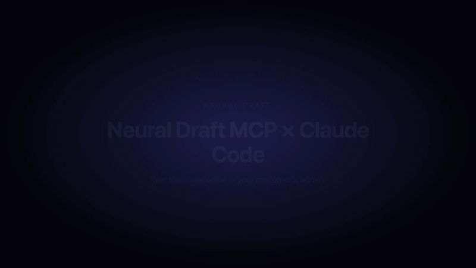

# Neural Draft MCP server (`@neuraldraft/mcp`)

> The backend for sites built with AI: CMS, blog, bookings, forms, shop and social, one database per client. Your coding assistant wires the CMS while it builds; clients edit in a web editor or through Claude.

[](https://www.npmjs.com/package/@neuraldraft/mcp)
[](https://www.npmjs.com/package/@neuraldraft/mcp)
[](https://registry.modelcontextprotocol.io/v0/servers?search=io.github.vbalagovic/neuraldraft-mcp)
[](LICENSE)
[](https://docs.neuraldraft.io/mcp/overview)

`@neuraldraft/mcp` is a [Model Context Protocol](https://modelcontextprotocol.io) server (stdio, MIT) for [Neural Draft](https://neuraldraft.io). Add it to Claude Code, Cursor, Codex or VS Code with a workspace API key, and while your assistant builds a client's site it can:

- read the brand (voice, audience, colours, fonts, languages) before it writes a line;
- create pages with SEO meta, and register editable content keys and components, so the client can change words and pictures in the Neural Draft editor without you;
- add a page or sub-page to the hosted site in its own design, with a menu link;
- set up bookable services, galleries and blog drafts, and read products, form submissions and newsletter sign-ups;
- work across several client workspaces from one server (agencies).

Every client is its own Neural Draft workspace with its own Postgres database, API keys and team. A key only reaches the workspace it belongs to.



## Install

You need Node 20+ and a workspace API key: in the Neural Draft admin, **Settings → For developers → API keys** (`ndsk_live_…`). Free plan included, no credit card.

### Claude Code

```bash
claude mcp add neuraldraft-dev -e NEURALDRAFT_API_KEY=ndsk_live_... -- npx -y @neuraldraft/mcp
```

Add `--scope project` to write it to the project's `.mcp.json`, and keep the key out of git with an env reference:

```json
{
  "mcpServers": {
    "neuraldraft-dev": {
      "command": "npx",
      "args": ["-y", "@neuraldraft/mcp"],
      "env": { "NEURALDRAFT_API_KEY": "${NEURALDRAFT_API_KEY}" }
    }
  }
}
```

Run `/mcp` to check it's connected.

### Cursor

`.cursor/mcp.json` (project) or `~/.cursor/mcp.json` (global):

```json
{
  "mcpServers": {
    "neuraldraft-dev": {
      "command": "npx",
      "args": ["-y", "@neuraldraft/mcp"],
      "env": { "NEURALDRAFT_API_KEY": "ndsk_live_..." }
    }
  }
}
```

### Codex

```bash
codex mcp add neuraldraft-dev --env NEURALDRAFT_API_KEY=ndsk_live_... -- npx -y @neuraldraft/mcp
```

or `~/.codex/config.toml`:

```toml
[mcp_servers.neuraldraft-dev]
command = "npx"
args = ["-y", "@neuraldraft/mcp"]
env = { NEURALDRAFT_API_KEY = "ndsk_live_..." }
```

### VS Code

`.vscode/mcp.json`:

```json
{
  "servers": {
    "neuraldraft-dev": {
      "type": "stdio",
      "command": "npx",
      "args": ["-y", "@neuraldraft/mcp"],
      "env": { "NEURALDRAFT_API_KEY": "ndsk_live_..." }
    }
  }
}
```

### Continue

`~/.continue/config.yaml`:

```yaml
mcpServers:
  - name: neuraldraft-dev
    command: npx
    args: ["-y", "@neuraldraft/mcp"]
    env:
      NEURALDRAFT_API_KEY: ndsk_live_...
```

## Several client workspaces (agencies)

Each client has its own workspace and its own key. Put them all in one server and switch between them with `list_workspaces` / `switch_workspace`; every other tool acts on the active workspace.

```json
{
  "mcpServers": {
    "neuraldraft-dev": {
      "command": "npx",
      "args": ["-y", "@neuraldraft/mcp"],
      "env": {
        "NEURALDRAFT_API_KEYS": "linden-bakery=ndsk_live_...,villa-lavanda=ndsk_live_...",
        "NEURALDRAFT_WORKSPACE": "linden-bakery"
      }
    }
  }
}
```

`NEURALDRAFT_API_KEYS` also accepts a JSON object (`{"linden-bakery":"ndsk_live_..."}`). See [Several workspaces](https://docs.neuraldraft.io/mcp/multi-workspace).

## Environment variables

| Variable | Required | Notes |
|---|---|---|
| `NEURALDRAFT_API_KEY` | one of these two | One workspace key, `ndsk_live_…` |
| `NEURALDRAFT_API_KEYS` | one of these two | Several workspaces: `name=key,name=key` or a JSON object |
| `NEURALDRAFT_WORKSPACE` | no | Which of `NEURALDRAFT_API_KEYS` is active at start (default: the first) |
| `NEURALDRAFT_API_URL` | no | Default `https://api.neuraldraft.io/v1` |
| `NEURALDRAFT_PROJECT_ID` | no | Override when one key spans several projects |
| `NEURALDRAFT_DISPLAY_NAME` | no | Friendly name in your client's server list |

`NEURAL_DRAFT_*` spellings are accepted as aliases. A missing or malformed key fails at start with a message showing a working config. Never commit keys.

## Remote / hosted connector

Neural Draft also runs a hosted remote MCP server, no API key and nothing to install:

```
https://neuraldraft.io/mcp
```

Streamable HTTP with OAuth sign-in (Google or an emailed code). It works in Claude, ChatGPT, Codex, Claude Code, Cursor and VS Code, and it adds what this package doesn't do: deploying a build (`deploy_site`, `rollback_site`), custom domains, editing live site texts, bookings and availability, the blog, social scheduling, and finished ads and reels crafted by Batchcraft for your brand. We don't offer AI image or video creation. We craft finished static ads and reels for your brand.

```bash
# Claude Code
claude mcp add --transport http neuraldraft https://neuraldraft.io/mcp
# Codex
codex mcp add neuraldraft --url https://neuraldraft.io/mcp && codex mcp login neuraldraft
```

Claude: **Customize → Connectors → Add custom connector**. ChatGPT: **Settings → Apps → Add custom MCP server**. Paste the URL and sign in. Setup for every app: [Hosted connector](https://docs.neuraldraft.io/guides/hosted-connector).

| | Hosted connector | `@neuraldraft/mcp` (this repo) |
|---|---|---|
| Auth | Sign-in (OAuth) | API key per workspace |
| Runs | Remote, Streamable HTTP | Locally via `npx` (stdio) |
| Best for | Hosting and deploying the site, client edits, domains, blog, bookings, socials | Wiring a codebase: brand, content keys, components, pages, galleries |
| Several clients | Tick workspaces at sign-in | `NEURALDRAFT_API_KEYS` |

Developers often add both to Claude Code or Codex.

## Tools

| Group | Tools |
|---|---|
| Workspaces | `list_workspaces`, `switch_workspace`, `find_workspaces` |
| Brand | `get_brand`, `update_brand` |
| Content | `create_translation_keys`, `get_content`, `list_content`, `delete_content`, `register_component`, `delete_component` |
| Pages | `create_page`, `list_pages`, `get_page`, `update_page`, `delete_page`, `add_site_page` |
| Images and galleries | `list_images`, `get_image`, `register_image`, `replace_image` (by URL), `delete_image`, `list_galleries`, `get_gallery`, `create_gallery`, `update_gallery`, `delete_gallery` |
| Blog | `generate_blog_post` (a draft in the brand's voice), `list_blog_posts`, `get_blog_post`, `update_blog_post` |
| Bookings and shop | `create_bookable_service`, `setup_booking_widget`, `list_products`, `get_product` |
| Forms | `list_newsletter_subscribers`, `list_contact_form_submissions` |
| Account | `get_usage`, `get_job` |

`generate_image` and `generate_video` are still registered for older clients but are retired: the API answers them with `410 media_generation_moved`.

### Resources

| URI | What |
|---|---|
| `brand://current` | Voice, audience, colours, fonts, languages. Read before generating UI. |
| `schema://blog-post` | Blog post response shape |
| `schema://product` | Product and variant shape |
| `schema://booking` | Services, bookings, availability |
| `conventions://editable-html` | The `data-translate` / `data-image-key` markup rules |
| `conventions://api-usage` | Auth, errors, rate limits, jobs |

### Prompts

| Prompt | What it does |
|---|---|
| `/scaffold-marketing-site` | A full marketing site wired to Neural Draft (brand, editable keys, components) |
| `/scaffold-blog-page` | A `/blog` index and post page in an existing project |
| `/connect-existing-site` | Make an existing static site editable through Neural Draft |

Full reference: [Tools, resources and prompts](https://docs.neuraldraft.io/mcp/tools-and-resources).

## Try it

> Read brand://current, build a hero and a services section for this site with editable keys, and register them with Neural Draft.

The assistant reads the brand, writes markup with `data-translate` and `data-image-key`, creates the keys and registers the sections, so they show up in the client's admin as editable.

## Docs

- [MCP overview](https://docs.neuraldraft.io/mcp/overview) and [setup](https://docs.neuraldraft.io/mcp/setup)
- [Editable markup](https://docs.neuraldraft.io/guides/editable-markup)
- [REST API](https://docs.neuraldraft.io/introduction) and the TypeScript SDK [`@neuraldraft/sdk`](https://github.com/vbalagovic/neuraldraft-sdk)
- [For developers and agencies](https://neuraldraft.io/developers)

## Local development

```bash
git clone https://github.com/vbalagovic/neuraldraft-mcp.git
cd neuraldraft-mcp
npm install
npm run lint    # tsc --noEmit
npm test
npm run build   # → dist/
```

Run against a local API:

```bash
NEURALDRAFT_API_KEY=ndsk_test_xxx NEURALDRAFT_API_URL=http://localhost:8080/v1 npm run dev
```

Inspect with the MCP Inspector: `npx @modelcontextprotocol/inspector node dist/index.js`.

The server is a thin wrapper over the Neural Draft Project API v1: every tool maps to one or a few REST calls. It never writes to stdout at runtime (stdio transport).

## Contributing

Issues and PRs welcome. Keep tests passing (`npm test`), use the existing `register*` helper pattern for new tools, and update the tables above for any new surface.

## License

[MIT](./LICENSE)

---

Built by [Neural Draft](https://neuraldraft.io). Questions: info@neuraldraft.io.
